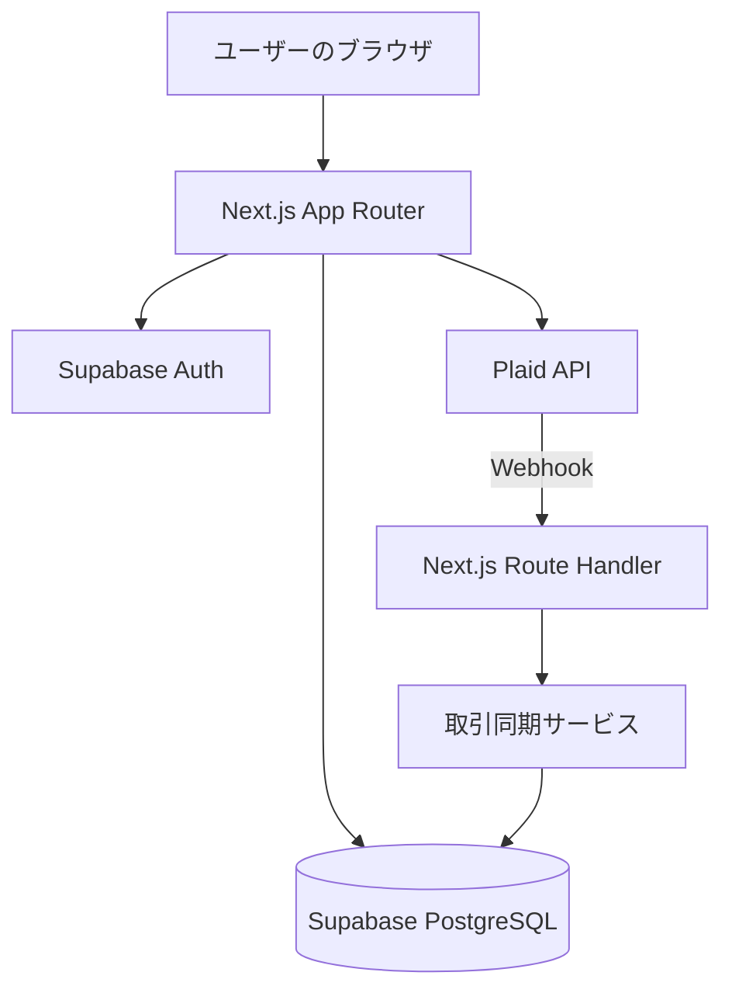

# BankOS / Obsidian Ledger

銀行取引データを取り込み、収支・支出カテゴリ・予算を一か所で確認できる個人開発の家計管理Webアプリケーションです。

BankOS is a personal finance web application built with Next.js, TypeScript, Supabase PostgreSQL, and Plaid. It focuses on authenticated data access, transaction synchronization, and spending analysis.

> **プロジェクトの位置付け**：ソフトウェアエンジニアとしての学習・個人開発作品です。金融機関向けの商用サービスではありません。

**[アプリを開く](https://expense-tracker-six-chi-16.vercel.app/dashboard)** · **[ソースコード](https://github.com/TakakiHashimoto/expense_tracker)**


## 主な機能

- **認証**：Supabase Authによるサインアップ、ログイン、認証済みユーザー向け画面の保護
- **口座連携**：Plaid Linkを利用した接続フローと口座情報の取得
- **取引同期**：Plaid Transactions Sync APIから追加・変更・削除された取引を取得し、PostgreSQLに反映
- **取引一覧**：月単位の表示、検索、フィルタリング、ソート、ページネーション
- **ダッシュボード**：収支、直近の取引、カテゴリ別支出などの集計表示
- **予算管理**：カテゴリ別・月別の予算設定と実績の比較
- **認可**：PostgreSQLのRow Level Security（RLS）およびサーバー側のユーザー確認によるデータアクセス制御

## 技術スタック

| 領域 | 技術 |
| --- | --- |
| Frontend / Application | Next.js 16 (App Router), React 19, TypeScript, Tailwind CSS 4 |
| Server-side | Next.js Server Actions, Route Handlers, Node.js |
| Authentication | Supabase Auth, `@supabase/ssr` |
| Database | Supabase PostgreSQL, SQL, Row Level Security |
| External API | Plaid API / Plaid Link（Sandboxを中心に検証） |
| Date handling | Luxon |
| Deployment | Vercel |

## システム構成



一般的な画面からの操作はNext.jsのサーバー側処理を経由します。外部の取引更新通知はWebhookで受け取り、署名を検証してから、同期サービスがPlaid APIとPostgreSQLを更新します。

## 技術的に工夫した点

### 1. 取引の増分同期と再実行を考慮した保存

PlaidのTransactions Sync APIでは、前回の同期位置を表す`cursor`を使って更新分を取得します。`has_more`が真の場合は続けて取得し、`added`、`modified`、`removed`をそれぞれ処理します。

- 取引IDに対応する一意制約を利用した`upsert`で、再同期時の重複登録を防ぐ設計
- Plaidとアプリの収支符号の違いを取り込み時に正規化
- ユーザーが手動変更したカテゴリを、取引更新によって不用意に上書きしない処理
- 同期完了後に`cursor`と同期状態を保存

実装：[同期フロー](src/features/plaid/server/syncPlaidItem.ts) / [取引の永続化](src/features/plaid/server/db.ts)

### 2. 同時同期を防ぐ期限付きロック

手動同期とWebhookが同じ口座接続に対して同時に実行されると、同じcursorから重複して処理を開始する可能性があります。そのため、`plaid_items`テーブルに期限付きの同期ロックを持たせています。

- PostgreSQL上の条件付き`UPDATE`でロックの獲得を試行
- ロック獲得者だけが保存済みcursorを読み取り同期を開始
- ロックの期限は5分
- 解放時は発行したトークンを照合し、別の処理のロックを誤って解除しないようにする

実装：[ロック取得](src/features/plaid/server/syncLease.ts) / [ロック解放](src/features/plaid/server/unlockRelase.ts)

### 3. Webhookの検証

PlaidからのWebhookをそのまま信用せず、署名付きJWTを検証しています。ES256の署名、トークンの有効期間、リクエスト本文のSHA-256ハッシュを確認した後に更新処理へ進みます。

実装：[Webhookエンドポイント](src/app/api/plaid/webhook/route.ts) / [検証処理](src/app/api/plaid/webhook/verifyWebhooks.ts)

### 4. ユーザーごとのデータアクセス制御

認証済みユーザーのIDでデータを絞り込み、PostgreSQLにもRLSポリシーを設定しています。アプリケーション側のチェックだけに依存しない、複数層でのアクセス制御を意識しました。

実装：`src/app/(protected)/layout.tsx` / [データベースマイグレーション](supabase/migrations/20260903011843_remote_schema.sql)

## 画面・デモ

現在の公開アプリは、ダッシュボードを表示するために認証が必要です。初見の方にも機能が伝わるように、以下を追加予定です。

- ダッシュボード、取引一覧、予算管理のスクリーンショット
- Plaid Sandboxでの口座接続から取引表示までの短いデモ動画
- 機密情報を含まないテストデータでの動作例

<!-- スクリーンショットを追加したら、例えば次の行を有効にします。


-->

## ローカルで起動する

### 前提条件

- Node.jsとnpm
- Supabaseプロジェクト
- Plaid開発者アカウント（Sandbox用のAPI認証情報）

```bash
git clone https://github.com/TakakiHashimoto/expense_tracker.git
cd expense_tracker
npm ci
```

プロジェクトルートに`.env.local`を作成し、必要な値を設定します。

```dotenv
NEXT_PUBLIC_SUPABASE_URL=
NEXT_PUBLIC_SUPABASE_PUBLISHABLE_KEY=
SUPABASE_SERVICE_ROLE_KEY=
PLAID_CLIENT_ID=
PLAID_SECRET=
PLAID_ENV=sandbox
```

`SUPABASE_SERVICE_ROLE_KEY`と`PLAID_SECRET`はサーバー側の秘密情報です。公開リポジトリやブラウザに露出させないでください。

Supabase側のスキーマ・RLSポリシーは`supabase/migrations`を参照してください。Supabaseプロジェクトへのマイグレーション適用と認証・メール設定が別途必要です。

```bash
npm run dev
```

開発サーバーは`http://localhost:3002`で起動します。その他のコマンドは`npm run build`と`npm run lint`です。

## 検証状況・制約

- 公開リポジトリの`package.json`には、現時点で専用のユニットテスト実行スクリプトがありません。自動テストの体系化は今後の課題です。
- 取引の保存は複数のデータベース操作から成り、全体が単一のデータベーストランザクションとして原子的に実行される設計ではありません。部分失敗時の復旧、再試行、整合性の保証方法は改善余地があります。
- Plaid接続はSandbox中心の検証です。実際の金融機関との商用運用実績を示すものではありません。
- 現在はカナダ向けの利用を想定した日付処理が含まれます。複数タイムゾーンへの対応は今後の課題です。

## 今後の改善予定

- 同期・認証・集計の自動テストの追加
- 同期失敗時の復旧戦略とDB整合性の強化
- 空状態、エラー表示、オンボーディングの改善
- デモ用データとスクリーンショットの整備
- タイムゾーン設定の一般化
- ユーザが増えた際のtransactionsのクエリー見直し

## 開発者

Takaki Hashimoto — ネットワーク運用・保守の実務経験を土台に、Backend / Full-stack開発を学んでいます。

[GitHubプロフィール](https://github.com/TakakiHashimoto)
